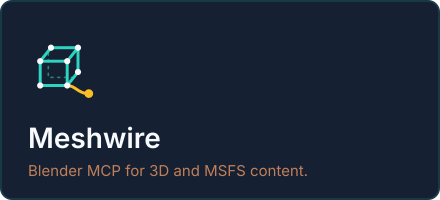
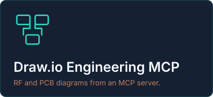
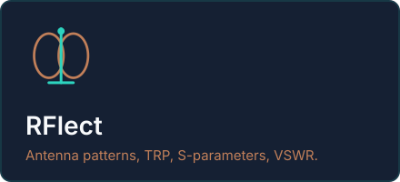
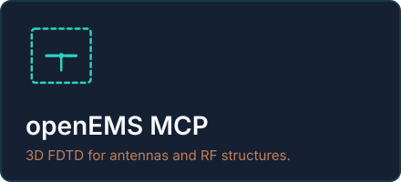
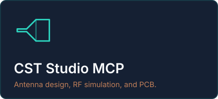
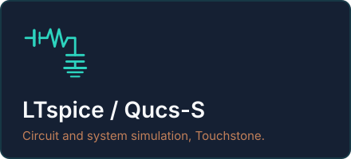
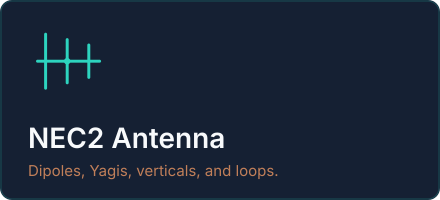

  <picture>
    <source media="(prefers-color-scheme: light)" srcset="assets/header-profile-light.svg">
    
  </picture>

6+ years designing antennas and RF front-ends for embedded wireless
platforms. Work covers custom antenna integration, multi-radio
coexistence, and test automation — VNA, chamber, and EMC.

**[rfpro.dev](https://rfpro.dev/) · [LinkedIn](https://www.linkedin.com/in/adamengelbrecht1/)**

## Selected public projects

<table>
  <tr>
    <td width="50%" valign="top">
      
    </td>
    <td width="50%" valign="top">
      
    </td>
  </tr>
</table>

<table>
  <tr>
    <td width="50%" valign="top">
      
    </td>
    <td width="50%" valign="top">
      
    </td>
  </tr>
</table>

<table>
  <tr>
    <td width="50%" valign="top">
      
    </td>
    <td width="50%" valign="top">
      
    </td>
  </tr>
</table>

<table>
  <tr>
    <td width="50%" valign="top">
      
    </td>
    <td width="50%" valign="top">
      
    </td>
  </tr>
</table>

## Also

| Project | What it is |
|---|---|
| [GNSS toolkit](https://github.com/RFingAdam/gnss-toolkit) | GNSS receiver evaluation: NMEA, AT-commands, TTFF, CEP₅₀ / CEP₉₅. |
| [RF interference calculator](https://github.com/RFingAdam/rf-interference-calculator) | Spectrum interference and IMD / harmonics for coexistence studies. |
| [mcp-remote-access](https://github.com/RFingAdam/mcp-remote-access) | SSH and serial access to benches and embedded targets. |
| [Siliconsmith](https://github.com/RFingAdam/siliconsmith) | Tiny Tapeout chip-design MCP: RTL, tests, and sky130 synthesis. |
| [Rushcut](https://github.com/RFingAdam/rushcut) | Editor-agnostic AI video editing over MCP (FFmpeg, VEGAS Pro, DaVinci Resolve). |
| [agentarchy](https://github.com/RFingAdam/agentarchy) | Arch + KDE Plasma 6 distro with an agent-first engineering runtime. |
| [VPN-AP](https://github.com/RFingAdam/VPN-AP) | Raspberry Pi travel router with VPN for hotel internet. |

## Links

- Portfolio: [rfpro.dev](https://rfpro.dev/)
- LinkedIn: [adamengelbrecht1](https://www.linkedin.com/in/adamengelbrecht1/)
